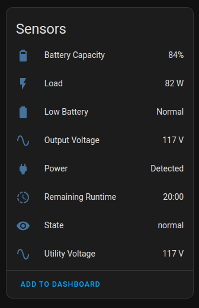

# CyberPower pwrstat Home Assistant Integration

[](https://github.com/hacs/integration)


A Home Assistant integration to monitor CyberPower UPS devices via the lightweight `pwrstat-api` wrapper.

---

## Features

* **Real-time Monitoring**: Tracks UPS load, battery capacity, input/output voltage, state, and remaining runtime.
* **Native Energy Sensor (`kWh`)**: Automatically calculates continuous cumulative kilowatt-hours using Riemann sum integration and state restoration. Ready out of the box for the **Home Assistant Energy Dashboard** without helper templates.
* **Load Percentage**: Dedicated load percentage sensor for dashboard gauges.
* **Binary Sensors**: Instant alerting for utility power presence and low battery status.
* **Dynamic Device Info**: Automatically discovers and displays your UPS model name and firmware version in the Home Assistant Device Registry.
* **UI Config & Options Flow**: Configure and reconfigure polling intervals and URLs directly from the UI with connection validation.
* **Lightweight Docker Wrapper**: Bundled under `extras/pwrstat/` using host socket mounts.

---

## Entities Provided

| Entity | Domain | Device Class | Unit / Values | Description |
| :--- | :--- | :--- | :--- | :--- |
| **Load** | Sensor | `power` | W (Watts) | Current power draw |
| **Load Percent** | Sensor | — | % | Load as percentage of rated capacity |
| **Energy** | Sensor | `energy` | kWh | Cumulative energy consumption (**Energy Dashboard**) |
| **Battery Capacity**| Sensor | `battery` | % | Battery charge level |
| **Output Voltage** | Sensor | `voltage` | V | Voltage delivered to connected equipment |
| **Utility Voltage** | Sensor | `voltage` | V | Line voltage from utility |
| **Remaining Runtime**| Sensor | `duration`| min | Estimated runtime on battery |
| **State** | Sensor | `enum` | `normal`, `power failure` | Status with diagnostic attributes |
| **Utility Power** | Binary Sensor | `power` | On / Off | `On` when utility power is normal |
| **Low Battery** | Binary Sensor | `battery` | On / Off | `On` when battery is below 35% |

---

## Requirements

The integration connects to an instance of `pwrstat-api` running on the machine physically connected via USB to your UPS. See [Running the Docker API](#running-the-docker-api) below.

---

## Installation

### Method 1: HACS (Recommended)

1. Ensure [HACS](https://hacs.xyz/) is installed in Home Assistant.
2. In Home Assistant, navigate to **HACS** > **Integrations**.
3. Click the three dots in the top right corner and select **Custom repositories**.
4. Enter:
   * **Repository**: `https://github.com/twrecked/hass-pwrstat`
   * **Type**: `Integration`
5. Click **Add**, locate **CyberPower pwrstat**, and click **Download**.
6. Restart Home Assistant.

### Method 2: Installation Script

Clone the repository and run the install script:

```bash
# Preview operations
./install /path/to/homeassistant/config

# Execute installation
./install go /path/to/homeassistant/config
```

Restart Home Assistant.

### Method 3: Manual Copy

Copy the `custom_components/pwrstat` directory into your Home Assistant `/config/custom_components/` directory and restart Home Assistant.

---

## Configuration

1. In Home Assistant, go to **Settings** > **Devices & Services**.
2. Click **+ Add Integration** and search for `pwrstat` or `Cyberpower`.
3. Fill in the fields:
   * **Name**: Friendly name for this UPS (e.g. `Office UPS`).
   * **URL**: Full URL to the API (e.g. `http://192.168.1.50:5002/pwrstat`).
   * **Polling Interval**: Seconds between status polls (default: `30`).
4. Click **Submit**.



You can add multiple UPS devices by repeating the process. To change the polling interval or URL later, select the integration and click **Configure**.

---

## Running the Docker API

The `extras/pwrstat` directory contains a minimal Docker setup that runs alongside CyberPower's native Linux daemon (`pwrstatd`). It mounts the host binary and IPC sockets directly into a slim Python 3.12 container:

```bash
cd extras/pwrstat

# Start container (defaults to ups-status on port 5002)
HOME_NAME=office docker compose up -d --build

# Verify API
curl http://127.0.0.1:5002/pwrstat
```

See [extras/pwrstat/README.md](extras/pwrstat/README.md) for full documentation and volume mounting details.

---

## Acknowledgments

* Based on the concept by [@bruggeman](https://github.com/sbruggeman/pwrstat-api).
